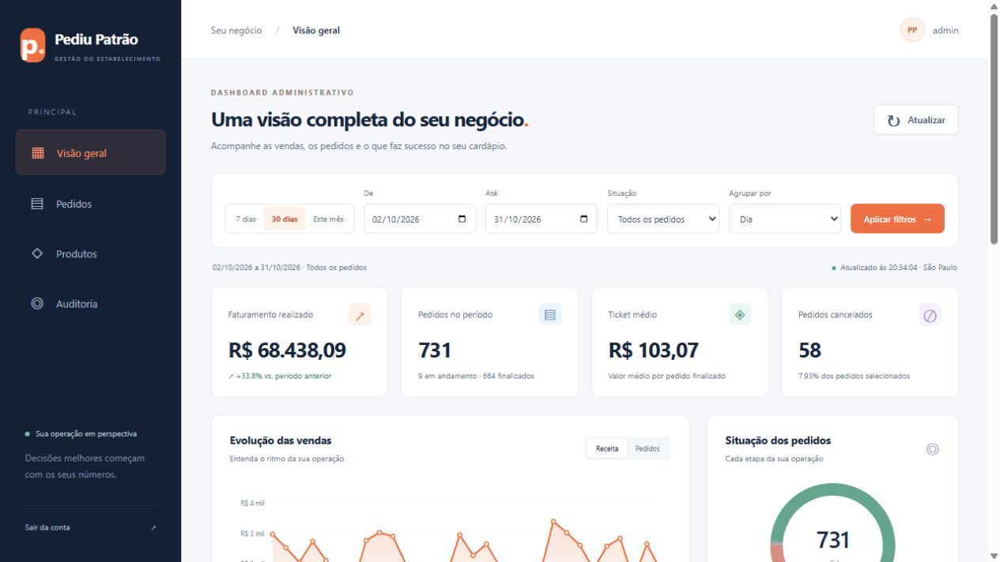

# Pediu Patrão

Sistema de pedidos para pizzaria com Spring Boot, Thymeleaf, Spring Security e MongoDB.

## Dashboard Administrativo

Abra **Dashboard** no menu lateral ou acesse `/dashboard` após entrar como `ADMIN` ou `GERENTE`. O painel consulta a API e o MongoDB reais, com indicadores de faturamento líquido, pedidos, ticket médio, cancelamentos, comparação com período anterior, gráficos, top 5 e pedidos paginados. Filtros por datas e situação, agrupamentos diário/semanal/mensal e atualização a cada 60 segundos.



### Entregáveis da atividade

- [Documento de requisitos funcionais e não funcionais](docs/dashboard/requisitos.md)
- [Documentação da API: parâmetros, exemplos e erros](docs/dashboard/api.md) e [contrato OpenAPI](docs/dashboard/openapi.yaml)
- [Arquitetura, modelagem e Gitflow](docs/dashboard/arquitetura.md)
- [Evidências de testes](docs/dashboard/testes.md)
- [Vídeo da demonstração](docs/dashboard/demonstracao.mp4) e [roteiro de apresentação](docs/dashboard/apresentacao.md)
- Código em `src/main/java/com/umc/pediupatrao/dashboard`, tela em `templates/dashboard.html` e testes em `src/test/java/com/umc/pediupatrao/dashboard`.

Fluxo de branches: `main` → `develop` → `codex/feature/dashboard-administrativo` → pull request para `develop`. O documento de arquitetura descreve a promoção após revisão.

### Demonstração com dados separados

Requisitos: **Java 21** e MongoDB **5.0 ou superior** (`$dateTrunc`). A configuração Docker e o CI usam MongoDB 8.0. Inicie um MongoDB local ou, com Docker disponível, execute `docker compose up -d`. Depois:

```powershell
$env:MONGODB_URI = 'mongodb://localhost:27017/pediupatrao_demo'
$env:MONGODB_DATABASE = 'pediupatrao_demo'
$env:APP_BOOTSTRAP_ADMIN_PASSWORD = Read-Host 'Defina a senha inicial do admin'
.\mvnw.cmd spring-boot:run '-Dspring-boot.run.profiles=demo'
```

Entre em [localhost:8080/login](http://localhost:8080/login) como `admin` com a senha definida e abra o Dashboard. O perfil `demo` gera 60 dias de pedidos fictícios somente em banco com sufixo `_demo` e com coleção de pedidos vazia. Para dados reais, execute sem esse perfil. Nenhuma senha é definida no código.

Para executar **também os testes com MongoDB real**, use um servidor local separado ou o MongoDB do Compose. Os testes usam exclusivamente o banco `pediupatrao_dashboard_test`:

```powershell
$env:MONGODB_TEST_URI = 'mongodb://localhost:27017/pediupatrao_dashboard_test'
.\mvnw.cmd verify
```

Sem `MONGODB_TEST_URI`, somente os testes de integração com banco são ignorados. O GitHub Actions executa a suíte completa com MongoDB.

## Execução

Requisitos: Java 21 e MongoDB.

Configure a conexão e a senha inicial do administrador no ambiente. A conta `admin` só é criada se ainda não existir e `APP_BOOTSTRAP_ADMIN_PASSWORD` estiver definido; a senha não é alterada em inicializações seguintes.

```powershell
$env:MONGODB_URI = "mongodb://localhost:27017/pizzaria"
$env:MONGODB_DATABASE = "pizzaria"
$env:APP_BOOTSTRAP_ADMIN_PASSWORD = "defina-uma-senha-forte"
.\mvnw.cmd spring-boot:run
```

Para executar os testes:

```powershell
.\mvnw.cmd test
```

## Perfis

- `ADMIN`: administra usuários e consulta pedidos e auditoria.
- `GERENTE`: gerencia pedidos, aplica descontos, cancela pedidos e consulta clientes e auditoria.
- `ATENDENTE`: cadastra e atualiza clientes, registra pedidos e acompanha o andamento.

As permissões são aplicadas no Spring Security, nos controllers e nos serviços. O cadastro de usuários não é público; somente `ADMIN` pode criar usuários ou atribuir perfis. A própria conta autenticada não pode trocar de perfil nem ser excluída. Senhas não são retornadas pelas APIs.

## Pedidos e auditoria

Pedidos são registrados no estado `RECEBIDO`. O fluxo permitido é `RECEBIDO` → `EM_PREPARACAO` → `PRONTO` → `SAIU_PARA_ENTREGA` ou `RETIRADO` → `FINALIZADO`. O servidor obtém os preços do catálogo e calcula subtotal, desconto e total. O gerente pode aplicar até 20% de desconto antes da saída ou cancelar antes da saída com justificativa.

Inclusões e alterações de pedidos e clientes são persistidas na coleção MongoDB `auditorias`, com usuário, perfil, horário, entidade, campos anteriores/novos e justificativa aplicável. A aplicação expõe somente consulta de auditoria para `ADMIN` e `GERENTE`; não há operações comuns para editar ou excluir esses registros.

## APIs principais

- `GET /api/pedidos`: lista pedidos para usuários autenticados.
- `POST /api/pedidos`: registra pedido com `clienteId` e `itens` (`produtoId`, `quantidade`); valores enviados pelo cliente são ignorados.
- `PUT /api/pedidos/{id}/status?status=...`: avança o pedido conforme o fluxo válido.
- `PUT /api/pedidos/{id}/desconto?percentual=10`: aplica desconto, exclusivo do gerente.
- `PUT /api/pedidos/{id}/cancelar?justificativa=...`: cancela, exclusivo do gerente.
- `GET /api/auditoria`: consulta registros, exclusivo de `ADMIN` e `GERENTE`.
- `GET /api/clientes`: consulta para gerente e atendente; `POST` e `PUT` são exclusivos do atendente.
- `/api/usuarios/**`: administração exclusiva de `ADMIN`.

CSRF permanece habilitado. Formulários Thymeleaf incluem o token automaticamente; clientes das APIs autenticadas por sessão devem enviar o token CSRF nos métodos que alteram dados.

## Demonstração

Para a entrega individual, grave na tela uma demonstração dos três perfis, das tentativas não autorizadas, do fluxo completo do pedido, do desconto/cancelamento, de uma alteração de cliente e dos registros correspondentes na tela de auditoria.
