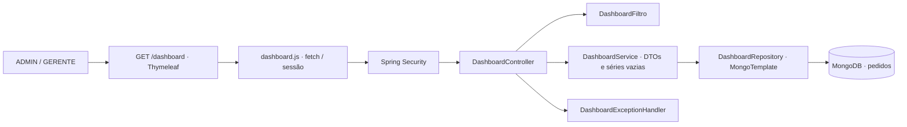
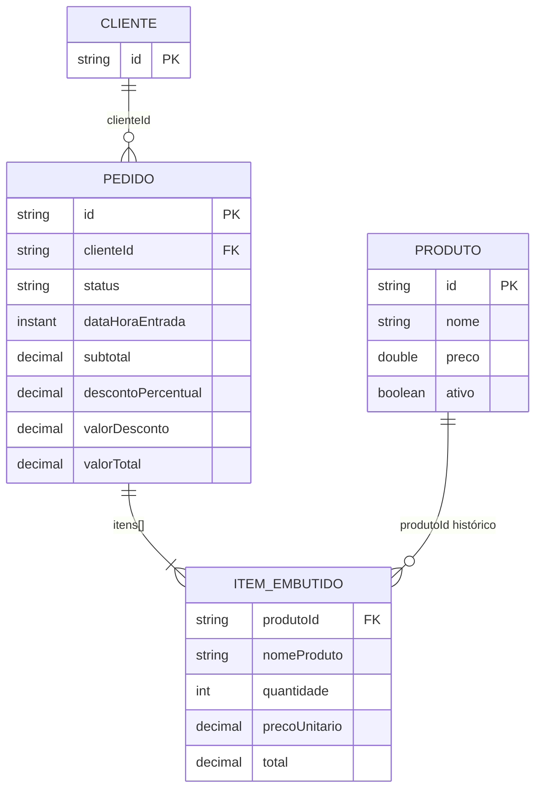

# Projeto da solução

## Decisões

- **Evoluir a aplicação existente:** Spring Boot 3.4.4, Java 21, Spring Security, Thymeleaf e MongoDB. Sem um segundo servidor, autenticação duplicada ou dados fictícios na API principal.
- **API orientada à consulta:** um endpoint consolidado para a visão geral evita múltiplas chamadas independentes para cada cartão; pedidos possuem rota separada porque são paginados; filtros vêm do servidor para compartilhar opções e fuso.
- **Cálculos no banco:** `$match` por data antes de normalização e `$facet`; agregações de resumo, status, série e produtos. Ranking limitado antes de retornar. A coleção não é copiada integralmente para a memória Java.
- **Snapshot histórico dos itens:** nome, quantidade, preço e total registrados no pedido continuam válidos mesmo que o produto seja alterado/excluído. Não há join do catálogo para recalcular vendas antigas.
- **Precisão:** `$convert` para decimal acomoda os valores legados gravados como string pelo Spring Data. Os DTOs usam `BigDecimal`; moeda é formatada em pt-BR apenas na interface.
- **Frontend:** página Thymeleaf autenticada e JavaScript `fetch` na mesma origem. Gráfico SVG e rosca CSS com legenda, sem dependência de CDN ou biblioteca de gráficos. O CSS é isolado do layout antigo.
- **Atualização:** consulta inicial, filtros explícitos, botão atualizar e intervalo de 60 segundos na aba visível. `AbortController` e número de versão impedem respostas antigas de sobrescrever filtros recentes; requisições de paginação também verificam a versão.
- **Erros:** `ProblemDetail` no controller, mensagens específicas para 401/403 e timeout de 15 segundos no cliente. Se os filtros mudaram, resultados antigos são ocultos ao falhar; numa atualização da mesma consulta, o timestamp e aviso indicam que os dados são anteriores.
- **Compatibilidade:** nenhuma alteração no fluxo transacional de pedidos. Criação do índice `dashboard_data_id` na inicialização. A conexão de implantação deve ter permissão para criar esse índice; em ambientes com privilégios restritos ele pode ser provisionado previamente pelo DBA.

## Componentes

## Modelo de dados

Não é necessária nova coleção de vendas: os pedidos existentes já contêm os fatos necessários. Evita duplicação e divergência entre pedido e indicador.

As relações em MongoDB não são constraints relacionais. `itens` é um array embutido e os nomes/preços são snapshots. O painel não consulta `clientes`. Índice composto: `{dataHoraEntrada: -1, _id: -1}`. Consulta de período: `[inicio 00:00 local, dia seguinte ao fim 00:00 local)`.

## Entrega com Gitflow

`main` é a base estável; `develop` é a base de integração; `codex/feature/dashboard-administrativo` contém esta implementação e seus testes. O prefixo `codex/` identifica a autoria da branch, mantendo a função de feature do Gitflow. A integração é proposta por pull request de feature para develop. A promoção de develop para main pode ser realizada após revisão.

## Limites conhecidos

- Pedidos sem data de entrada não podem ser atribuídos a um período; não são inventados valores para registros sem total.
- O dashboard lê o estado atual do pedido; não reconstrói o status que ele tinha no passado. Para essa consulta histórica é necessária outra modelagem com eventos de status.
- Receita de itens no ranking é bruta e a receita do indicador é líquida; descontos globais não são rateados artificialmente.
- Limites de período/paginação e índice não substituem teste de carga e monitoramento. `$facet` possui limites próprios de memória do MongoDB.
- Testes de MongoDB são habilitados por `MONGODB_TEST_URI`; o CI sempre fornece essa variável. Sem ela, a suíte sinaliza esses testes como ignorados.

## Referências técnicas

[Spring Data MongoDB: agregações](https://docs.spring.io/spring-data/mongodb/reference/mongodb/aggregation-framework.html), [MongoDB: $facet e uso de índices](https://www.mongodb.com/docs/manual/reference/operator/aggregation/facet/).
